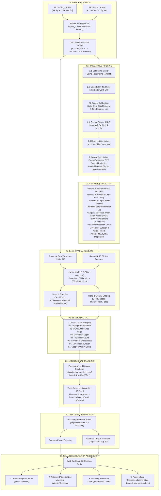

# AKIRA Knee Rehabilitation System: Smart Post-ORIF Edge-AI Kinematic Tracking

**Project:** Smart Post-ORIF Rehabilitation Ecosystem with Edge-AI Kinematic Tracking (AKIRA)  
**Component Focus:** Knee Joint Rehabilitation Following Tibial Plateau Open Reduction and Internal Fixation (ORIF)  
**Investigator:** Wickramarathna S A (IT23222540)  

---

## 1. Executive Summary

This repository contains the ESP32 dual-IMU firmware, a reproducible multi-dataset preprocessing pipeline, a 3D Madgwick sensor-fusion knee-angle and 16-feature extractor, subject-independent dual-stream hybrid deep-learning models, a full-int8 TensorFlow Lite edge model, and a FastAPI/Chart.js web application for **post-ORIF knee rehabilitation**.

### Key Points (all numbers are reproduced by the scripts in `app/api/`)
* **Multi-dataset corpus (`997` windows, `87` subject IDs, 4 public datasets):** KneE-PAD, PHYTMO, StrengthSense and HuGaDB. Every exercise comes from at least two datasets. Signals are never rescaled.
* **Quality labels only from published ground truth:** KneE-PAD fault codes and PHYTMO correct/wrong labels. StrengthSense and HuGaDB have no correctness annotation, so their windows (and therefore all Step-Up windows) are marked *unlabelled* and train exercise recognition only.
* **Knee angle:** 6-DoF Madgwick fusion per sensor, relative orientation in the thigh frame, projection on the knee hinge axis, referenced to the most-extended posture of each recording (never negative).
* **OptiTrack validation (97 trials, no agreement-based exclusion):** angle-trace error ignoring polarity, median **3.43°** (mean 5.84°). Polarity agrees with OptiTrack in **79.4%** of trials (see §4B).
* **Subject-independent evaluation:** 3-way split (57 / 12 / 18 subjects) plus full 5-fold cross-validation. Exercise accuracy **96.5%** on unseen people (5-fold **97.0% ± 1.6%**). Quality accuracy **56.6%** on labelled test windows (5-fold **57.6% ± 3.1%**).
* **Edge model:** `akira_hybrid_cnn_edge.tflite`, **76.91 KB**, verified **full int8** (no float internal tensors), plus the complete C byte array. On-device ESP32 latency is **not measured yet** because the firmware does not run TFLite Micro.

---

## 2. End-to-End Component Flow & Architecture (Boxes 01 to 08)

The knee rehabilitation component implements the multi-stage clinical pipeline specified in the project proposal and methodology architecture diagram:



### Detailed Breakdown by Stage

#### Box 01: Data Acquisition
* **Sensors:** Two 6-axis MPU-6050 IMUs (3-axis Accelerometer + 3-axis Gyroscope = 6 channels per unit).
* **Placement:** Thigh (address `0x68`, anterior femur) and Shin (address `0x69`, anterior tibia).
* **Firmware:** [`firmware/esp32_firmware.ino`](firmware/esp32_firmware.ino) samples simultaneously at **$100\text{ Hz}$** ($10\text{ ms}$ interval), packaging a synchronized 12-channel stream streamed over BLE or Serial.

#### Box 02: Knee Angle Computation Pipeline (`app/api/math_feature_extractor.py`)
1. **2.1 Synchronization:** Cubic-spline temporal resampling onto a strict uniform $100.0\text{ Hz}$ time grid ($\Delta t = 0.01\text{ s}$).
2. **2.2 Noise Filtering:** 4th-order zero-phase $5.0\text{ Hz}$ Butterworth low-pass filter suppresses tremor and mechanical noise without phase delay.
3. **2.3 Calibration:** Detects rest periods to remove static zero-rate gyro bias and measures baseline extension deficit ($\le 25^\circ$).
4. **2.4 Sensor Fusion:** 6-DoF Madgwick orientation quaternion tracking ($q_{\text{thigh}}$ and $q_{\text{shin}}$) initialized directly from gravity.
5. **2.5 Relative Orientation:** Quaternion conjugate product $q_{\text{rel}} = q_{\text{thigh}}^* \otimes q_{\text{shin}}$ yields relative rotation from shin to thigh.
6. **2.6 Knee Angle Calculation:** Rotates shin angular velocity into the thigh frame, computes SVD to isolate the true anatomical sagittal hinge axis $\mathbf{u}_{\text{hinge}}^{(T)}$, and extracts signed flexion and true hyperextension ($<0^\circ$) without artificial clipping:
   $$\theta(t) = 2 \arctan2(\mathbf{q}_v \cdot \mathbf{u}_{\text{hinge}}, q_w) + \text{tare\_angle}$$

#### Box 03: Feature Extraction (The 16 Biomechanical Features)
Computes a standardized 16-D feature vector mapping directly to the 7 diagram categories:
* **3.1 Knee Angle:** `mean_angle` (F14), `angle_std` (F09), `angle_rms` (F15), and `extension_return_deficit_deg` (F03).
* **3.2 Range of Motion (ROM):** `rom_deg` (F01) and `angle_iqr` (F11).
* **3.3 Angular Velocity:** `peak_angular_velocity` (F04), `mean_angular_velocity` (F05), `velocity_std` (F10), `max_ang_vel` (flexion speed, F12), and `min_ang_vel` (extension speed, F13).
* **3.4 Movement Depth:** `peak_depth_deg` (F02, true maximum flexion depth).
* **3.5 Movement Smoothness:** `sparc_smoothness` (F06, spectral arc length of angular velocity).
* **3.6 Repetition Count:** `repetition_count` (F07, adaptive peak-prominence cycle detection).
* **3.7 Movement Duration:** `mean_repetition_duration` (F08, cycle duration) and `sparc_per_duration` (F16, normalized smoothness rate).

#### Box 04: AI Model (Dual-Stream Hybrid Deep Learning)
* **Stream A:** Raw 12-channel IMU sequence ($200 \times 12$).
* **Stream B:** 16-D clinical feature vector ($16$).
* **Model Families:** 6 benchmarked hybrid architectures (1D-CNN, BiLSTM, CNN-BiLSTM, 1D-ResNet, Self-Attention, Gated Attention) fusing temporal and kinematic representations.
* **Dual Output Heads:** Exercise Class Classification (4 dynamic classes) and Movement Quality Grading (Good, Needs Improvement, Bad).  
  *Phase 1 acute exercises (Heel Slides, Quad Sets, SLR) activate **Kinematic Protocol Mode** for safety and kinematic tracking.*
* **Edge AI:** Full int8 quantized TensorFlow Lite model (`akira_hybrid_cnn_edge.tflite`, **76.91 KB**, pure `TFLITE_BUILTINS_INT8`) exported to C array (`edge_akira_classifier.c`).

#### Box 05: Session Output (The 7 Official Session Outputs)
1. `out_01_recognized_exercise`: Exercise class or protocol mode.
2. `out_02_rom_deg` & `out_02_max_knee_angle_deg`: Active joint excursion and maximum flexion angle.
3. `out_03_peak_flexion_deg`: Functional movement depth.
4. `out_04_rep_count`: Validated repetition count.
5. `out_05_smoothness_score`: SPARC smoothness index ($0\text{ to }1$).
6. `out_06_duration_s`: Active session duration.
7. `out_07_movement_quality_score`: Composite quality score ($0\text{ to }100$).

#### Box 06: Longitudinal Tracking
* **Privacy-Preserving Storage:** Patient IDs are hashed via salted SHA-256 (`PT-...`). Stored in `app/api/datasets/longitudinal_sessions.json`.
* **Trend Analysis:** Tracks session-by-session progression ($S_1, S_2, S_3, \dots$) and calculates improvement slopes ($\Delta\text{ROM/session}$, $\Delta\text{Depth/session}$, $\Delta\text{Quality/session}$).

#### Box 07: Recovery Prediction Engine
* **Regression Modeling:** Fits recovery regression trajectories across historical points ($n \ge 3$ sessions).
* **Milestone Forecasting:** Compares projected trajectory against clinician targets in `clinician_protocols.json` (e.g. $90^\circ$ for Seated Knee Extension) to calculate estimated sessions and weeks to recovery.

#### Box 08: Final Rehabilitation Assessment (Dashboard & Clinician Portal)
* **Current Progress:** Displays ROM gain since baseline and current functional capability.
* **Estimated Time to Next Milestone:** Projected date and remaining sessions.
* **Recovery Trajectory:** Interactive Chart.js graph displaying historical progress curves alongside projected recovery forecasts.
* **Personalized Recommendations:** Safe flexion compliance alerts (e.g. $\le 45^\circ$ during mini squats), repetition cadence pacing, and extensor lag warnings.

---

## 3. Unseen-Subject Benchmark (`200` held-out test windows, `18` unseen subjects)

Quality metrics use only the **129** test windows that have a ground-truth quality label.

| Rank | Model Architecture | Parameters | Val Score (%) | Exercise Acc (%) | Exercise Macro F1 (%) | Quality Acc (%) | Quality Macro F1 (%) | Combined (%) | Host PC Latency |
| :---: | :--- | :---: | :---: | :---: | :---: | :---: | :---: | :---: | :---: |
| **#1** | **Hybrid 1: 1D-CNN + Kinematics (Edge Model)** | 55,879 | 80.94 | **96.50** | 96.95 | **60.47** | 58.76 | **78.48** | 0.055 ms (TFLite) |
| **#2** | **Hybrid 4: 1D-ResNet + Kinematics** | 159,431 | 80.75 | 96.00 | 96.28 | 58.91 | 57.77 | **77.46** | 0.56 ms |
| **#3** | **Hybrid 2: BiLSTM + Kinematics** | 103,559 | 78.79 | 95.00 | 94.87 | 55.04 | 52.69 | **75.02** | 2.61 ms |
| **#4** | **Hybrid 5: Self-Attention + Kinematics** | 42,055 | 82.53 | 95.00 | 95.29 | 54.26 | 51.89 | **74.63** | 0.63 ms |
| **#5** | **Hybrid 6: Gated Attention + Kinematics** | 43,335 | 78.69 | 96.00 | 95.80 | 51.94 | 50.67 | **73.97** | 0.47 ms |
| **#6** | **Hybrid 3: CNN-BiLSTM + Kinematics** | 97,223 | 83.18 | 95.00 | 95.05 | 49.61 | 47.42 | **72.31** | 0.75 ms |
| — | *Baseline 2: Single-IMU 1D-CNN (Thigh 6-Ch)* | — | — | 97.50 | 97.47 | 46.51 | 45.38 | 72.01 | — |
| — | *Baseline 1: Random Forest (16 Features)* | — | — | 74.00 | 72.07 | 46.51 | 44.11 | 60.26 | — |

Full report: [`app/docs/HYBRID_MODELS_BENCHMARK.md`](app/docs/HYBRID_MODELS_BENCHMARK.md) (generated by `train_models.py`).

---

## 4. Clinician Rehabilitation Protocols & Safe Flexion Limits

Defaults from `main.py`, editable through `/api/clinician/protocol`:

| Exercise | Target ROM ($^\circ$) | Max Safe Flexion ($^\circ$) | Max Return Deficit ($^\circ$) | Frequency |
| :--- | :---: | :---: | :---: | :---: |
| **Mini Squat** | $42$ | **$45$** ($30^\circ\text{--}45^\circ$ safe zone) | $\le 5$ | 3 / week |
| **Seated Knee Extension** | $90$ | $100$ | $\le 5$ | 3 / week |
| **Step-Up** | $65$ | $75$ | $\le 5$ | 2 / week |
| **Walking** | $60$ | $70$ | $\le 5$ | 3 / week |

---

## 5. Validation Honesty & Research Limitations

### A. What the second IMU adds
For **exercise recognition** a thigh-only IMU is as good as both IMUs (97.5% vs 96.5%). The second IMU is needed for **joint kinematics**: the knee angle, ROM, peak depth and extension return deficit are all measured from the relative thigh–shin orientation, which a single sensor cannot observe. It also helps quality grading (56.6% vs 48.1%).

### B. OptiTrack validation (`app/api/models/optitrack_validation_metrics.json`)
* **Method:** the system's own `compute_knee_angle` vs OptiTrack thigh/shin rigid bodies on PHYTMO. Both are projected on their own hinge axis and use the same polarity rule independently. No rescaling, no high-pass filter, and no trial excluded for disagreeing with the IMU.
* **Evaluated:** 97 trials. Excluded with logged reasons: 34 optical drop-outs, 7 failed synchronisations, 5 files without rigid bodies.
* **Results on the 93 windows the system accepts (ROM 4–155°):**
  * Angle-trace error ignoring polarity: mean **5.84°**, median **3.43°**.
  * As output: mean **12.45°**, median **4.17°**.
* **Polarity:** IMU data alone cannot tell flexion from extension without a known sensor orientation. The angle direction is therefore a convention, and it agrees with OptiTrack in **79.4%** of trials. ROM, angular speed, SPARC and repetition timing do not depend on it. A fixed, documented sensor orientation on the AKIRA hardware (or a one-time calibration movement) would remove this ambiguity.

### C. Knee-angle zero and extensor lag
The angle is measured from the most-extended posture **in each recording**, not from anatomical full extension: the public datasets have no straight-leg calibration pose. Feature 3 is therefore the **extension return deficit** (how completely the knee returns to extension between repetitions), not an absolute extensor lag.

### D. Hardware claims
* **Latency:** 12.8 ms per 2 s window on the host PC (feature extraction 12.7 ms + TFLite 0.10 ms). ESP32 on-device latency is **not measured**: the firmware does not yet run TFLite Micro.
* **Dual-IMU synchronisation:** **not measured** on AKIRA hardware. Saved recordings are resampled and do not keep per-sample device timestamps. The expected skew from the shared I2C bus is ~1.3 ms (a design figure, not a measurement).

### E. Dataset limitations (threats to validity)
* **Mini Squat** source data are squats of 75–115° median ROM; no public mini-squat recordings exist. The class learns the squat pattern, and depth safety is judged from the measured ROM.
* **Step-Up** source data are stair ascent (HuGaDB `going_up`; StrengthSense odd takes, inferred from the take order because the dataset labels ascent and descent alike), the closest available proxy for a step-up.
* **Quality** grades exist only for Walking, Seated Knee Extension and Mini Squat. Step-Up quality is not validated, and the app says so. Labels are dataset fault codes, not physiotherapist ratings.
* **HuGaDB** contains many saturated (±2000°/s) gyroscope recordings; 320 such windows and 206 non-physiological windows were rejected and logged.
* Participants are healthy or general knee-pathology volunteers, not tibial plateau ORIF patients. Target-population data collection with the AKIRA device remains necessary.

### F. Security
Patient IDs are stored only as salted SHA-256 pseudonyms. No API key is stored in the source code: set the `AKIRA_API_KEY` environment variable to require an `X-AKIRA-API-Key` header on patient-data endpoints. Without it the server runs in local-development mode (bound to `127.0.0.1`).

---

## 6. Repository Structure & Quick Start

* [`app/README.md`](app/README.md) — Architecture, hardware, datasets and operational guide.
* [`app/docs/HOW_16_FEATURES_ARE_CALCULATED.md`](app/docs/HOW_16_FEATURES_ARE_CALCULATED.md) — Knee-angle pipeline (Steps 2.1–2.6) and all 16 features.
* [`app/docs/HYBRID_MODELS_BENCHMARK.md`](app/docs/HYBRID_MODELS_BENCHMARK.md) — Generated benchmark, 5-fold CV, baselines and TFLite report.
* [`app/api/preprocess_datasets.py`](app/api/preprocess_datasets.py) — Multi-dataset builder and OptiTrack validator.
* [`app/api/math_feature_extractor.py`](app/api/math_feature_extractor.py) — Sensor fusion, knee angle and 16-feature extractor.
* [`app/api/train_models.py`](app/api/train_models.py) — Subject-independent trainer, 5-fold CV and full-int8 TFLite exporter.
* [`app/api/evaluate_nfr_metrics.py`](app/api/evaluate_nfr_metrics.py) — NFR report (states where each result was measured).
* [`app/api/main.py`](app/api/main.py) — FastAPI server, ESP32 recorder and longitudinal analytics.
* [`app/tests/test_akira_system.py`](app/tests/test_akira_system.py) — `pytest` suite.

```powershell
# Run the Web Application Dashboard
python app/run_web_app.py
```
