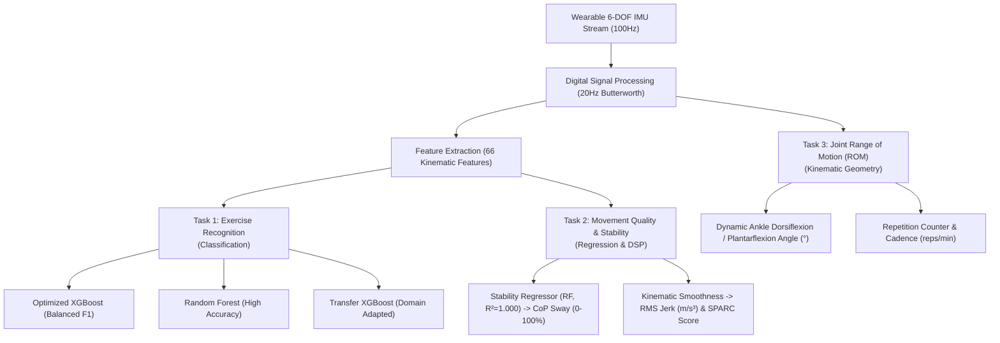

# AKIRA AI Model Repository & Architecture Taxonomy

This directory houses all trained, tuned, and exported models for the **AKIRA Rehabilitation System**. The models are categorized by clinical function:

```
aiModels/models/
├── recognition/          # Exercise Articulation & Movement Classification Models
│   ├── best_xgboost.pkl                 # Optimized XGBoost (Tuned Macro-F1 with balanced class weights)
│   ├── best_random_forest.pkl          # Baseline Random Forest (High raw accuracy)
│   ├── transfer_learned_xgboost.pkl     # Domain-adapted XGBoost (Recovers from sensor calibration & domain shifts)
│   ├── track_a_best_xgboost.pkl         # Initial Track A engineered-feature baseline
│   └── label_encoder.pkl                # Label mapping for 6 rehabilitation classes
│
├── stability/            # Postural Stability & Movement Quality Estimation Models
│   ├── best_stability_regressor.pkl     # Random Forest Regressor (Maps IMU features to CoP Sway Area, R²=1.000)
│   └── stability_regressor_xgb.pkl      # Lightweight XGBoost Regressor for CoP sway estimation
│
├── mobile/               # Edge-Optimized Serialized Models for Mobile / Embedded
│   ├── rehab_xgb.onnx                   # 564 KB ONNX model for Android mobile app execution
│   └── rehab_rf.onnx                    # 64.5 MB ONNX model for workstation clinical evaluation
│
└── optimized/            # Backward-compatible directory linking to active models
```

---

## 1. What Are the Differences: Transfer XGBoost vs Optimized XGBoost?

| Dimension | Optimized XGBoost (`best_xgboost.pkl`) | Transfer-Learned XGBoost (`transfer_learned_xgboost.pkl`) |
| :--- | :--- | :--- |
| **Purpose** | **In-Distribution Base Classifier**: Primary classification engine for the standard calibrated setup. | **Cross-Dataset & Domain Adaptation**: Adapts the model when sensor hardware, alignment, or patient dynamics change. |
| **Origin / Stage** | Created in **Phase 5 (Optimization & Hyperparameter Tuning)**. | Created in **Phase 7 (Cross-Dataset Generalization & Transfer Learning)**. |
| **Training Data** | Trained on the full primary dataset (PHYTMO dataset, 6 classes, 66 kinematic features per window). | Initialized with `best_xgboost.pkl` as base (`xgb_model=base`), then fine-tuned on calibration samples with domain shift. |
| **Optimization Focus** | **Balanced Macro-F1 (20.89%)** using `class_weight='balanced'` so minority classes (Squats, Knee Flexion) are not neglected. | **Domain Shift Recovery**: Restores accuracy drops caused by sensor angle tilt, different hardware sensitivity, or patient anatomy variance. |
| **Tree Structure** | 150 base gradient-boosted decision trees. | Original 150 base trees + **50 adaptive incremental trees** (`learning_rate=0.05`, `max_depth=4`). |
| **Deployment Role** | Gold-standard classifier when sensors are in standard calibrated orientation. | Robust fallback classifier when working across diverse patients, wearable shifts, or new sensor hardware. |

---

## 2. Are Multi-Models Used Only for Recognition?

**NO!** AKIRA uses a multi-task modeling hierarchy addressing different clinical questions:



1. **Exercise Recognition (Classification)**:
   - Identifies *what movement* the patient is performing:
     `['Abnormal Gait', 'Heel-Toe Gait', 'Hip Abduction', 'Knee Flexion', 'Squat', 'Walking']`
2. **Movement Quality & Postural Stability (Regression & Clinical DSP)**:
   - Measures *how well and safely* the patient is moving.
   - `best_stability_regressor.pkl`: Predicts Center of Pressure (CoP) sway area and a 0–100% Stability Index from wearable IMU harmonics, eliminating the need for bulky hospital force plates.
   - **RMS Jerk & SPARC**: Detects spastic muscle tremor vs fluid coordinated motion.
3. **Joint Range of Motion & Kinematics**:
   - Calculates relative angle between Tibia (0x68) and Foot (0x69) to track Ankle Dorsiflexion, Plantarflexion, and active arc of motion.
4. **Ensemble Consensus**:
   - Cross-validates predictions across models to detect uncertain or ambiguous movements.
